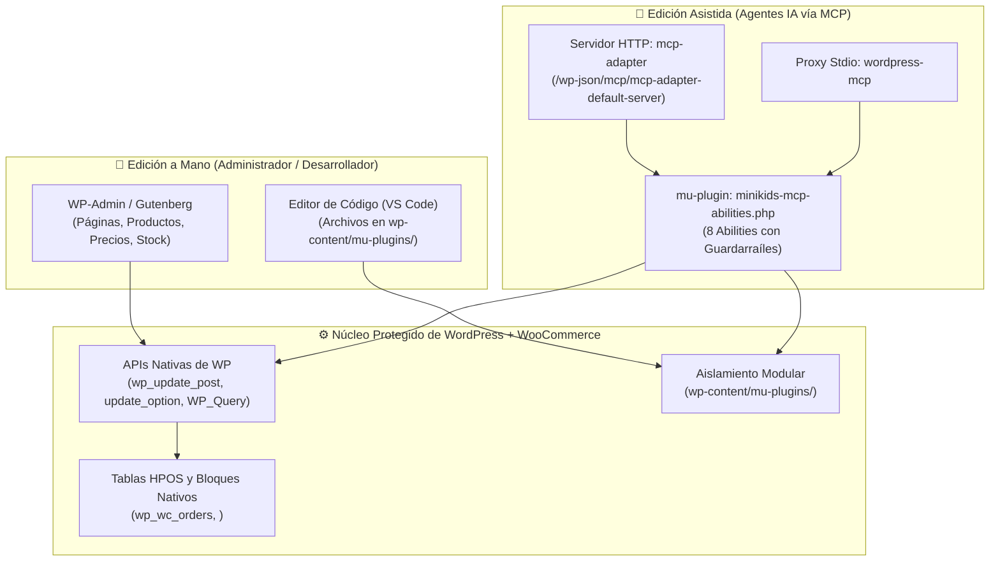
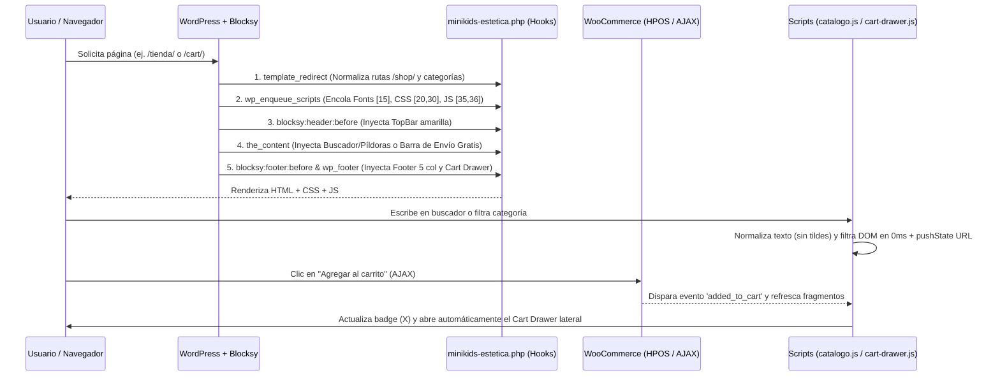
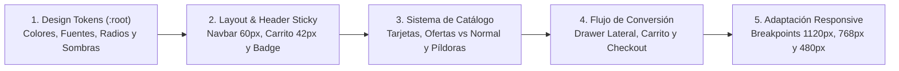

# Arquitectura de Implementación con MCP, Lógica Procedural y Desarrollo del Diseño · MiniKids Perú

Este documento técnico explica en detalle **cómo se ha construido la tienda MiniKids Perú** sobre WordPress + WooCommerce bajo tres pilares fundamentales:
1. **Integración con MCP (Model Context Protocol) y edición híbrida (Manual + IA)** diseñada para evitar roturas del sistema.
2. **Lógica por procedimientos (Procedural Architecture)** en Backend (PHP Hooks) y Frontend (JavaScript orientado a eventos).
3. **Metodología de desarrollo del diseño (Design System & CSS Override Architecture)** para transformar un tema clásico (Blocksy) en una interfaz moderna tipo Next.js.

---

## 1. Implementación con MCP y Edición Híbrida (A Mano + IA sin Romper el Sitio)

### 1.1. ¿Por qué suele romperse WordPress + WooCommerce al editarse?
En un entorno tradicional de WordPress con WooCommerce y HPOS (*High-Performance Order Storage*), el sitio se rompe cuando:
- Se edita directamente la base de datos con consultas SQL (`UPDATE wp_posts...`), lo que desincroniza las cachés de objetos de WooCommerce y corrompe los metadatos serializados.
- Se inyecta HTML libre sin estructura de bloques dentro del editor Gutenberg, provocando el error *"Este bloque contiene contenido inesperado o no válido"* al abrir la página a mano.
- Se modifican archivos internos del tema (`wp-content/themes/blocksy/`) o del plugin (`wp-content/plugins/woocommerce/`), perdiendo los cambios al actualizar o causando errores fatales de PHP.

Para solucionar esto de raíz, **MiniKids Perú implementa una arquitectura de doble vía (Edición Híbrida)** donde tanto una persona (a mano) como un agente de IA (vía MCP) operan sobre las mismas APIs nativas y archivos encapsulados.



---

### 1.2. Cómo funciona el mu-plugin `minikids-mcp-abilities.php`
Ubicado en `wp-content/mu-plugins/minikids-mcp-abilities.php`, este módulo se carga automáticamente en cada petición de WordPress sin necesidad de activación manual y registra la categoría `minikids` en la **WordPress Abilities API**.

Expone **8 herramientas (abilities)** con validación de esquemas JSON (`input_schema`) y control de permisos (`current_user_can('manage_options')`):

| Ability MCP | Tipo | Procedimiento Interno Seguro | Por qué no rompe la edición manual |
| :--- | :---: | :--- | :--- |
| `minikids/list-content` | Lectura | Ejecuta `WP_Query` ordenado por `ID ASC` filtrando por `post_type` y `post_status`. | Solo consulta mediante la API oficial de WP. |
| `minikids/get-content` | Lectura | Usa `get_post($id)` y devuelve el `post_content` exacto con sus comentarios de bloques `<!-- wp:... -->`. | Permite inspeccionar la estructura exacta de Gutenberg antes de editar. |
| `minikids/update-content` | Escritura | Usa `wp_update_post($data, true)` pasando `ID`, `post_title`, `post_content` y `post_status`. | Al usar `wp_update_post()`, WordPress dispara los hooks internos de limpieza de caché, revisiones e índice de bloques. El usuario puede abrir la página en Gutenberg inmediatamente después sin errores. |
| `minikids/get-option` | Lectura | Invoca `get_option($name, null)` desde `wp_options`. | Deserializa automáticamente arrays y objetos de configuración de WooCommerce/Blocksy. |
| `minikids/update-option` | Escritura | Invoca `update_option($name, $value)` aceptando tipos complejos JSON. | Serializa en formato nativo de PHP sin corromper longitudes de strings en la BD. |
| `minikids/list-plugins` | Lectura | Usa `get_plugins()` y cruza con `get_option('active_plugins')`. | Diagnóstico limpio del estado de plugins sin tocar archivos. |
| `minikids/read-file` | Lectura | Pasa por el guardarraíl `mkp_mcp_resolve_path($path)` y lee con `file_get_contents()`. | Bloquea lecturas fuera de `wp-content`. |
| `minikids/write-file` | Escritura | Valida ruta con `mkp_mcp_resolve_path()`, **crea un backup automático** `.bak-YYYYMMDD-HHMMSS` y escribe con `file_put_contents()`. | Si una edición de CSS o JS falla, existe un respaldo instantáneo con marca de tiempo. |

---

### 1.3. Guardarraíles Técnicos Anti-Rotura (Cómo editar a mano o con MCP con seguridad)

1. **Confinamiento de rutas (`mkp_mcp_resolve_path`):**
   - La función convierte cualquier ruta relativa a `realpath(WP_CONTENT_DIR)`, rechaza cualquier intento de *path traversal* (`..`) y verifica que el directorio destino comience estrictamente por `wp-content`. Ni un humano por error de comando en MCP ni un script pueden sobrescribir archivos del core de WordPress (`wp-admin`, `wp-includes` o `wp-config.php`).
2. **Separación entre Contenido Editable y Envoltorio Visual:**
   - **En la Base de Datos (editable a mano en WP-Admin):** Las páginas (Portada ID 8, Tienda ID 9) guardan **únicamente bloques nativos de Gutenberg** (`<!-- wp:group -->`, `<!-- wp:heading -->`, `<!-- wp:columns -->`). Si el usuario entra a *Páginas → Editar* desde el navegador, puede cambiar textos, títulos o imágenes visualmente.
   - **En `mu-plugins` (editable a mano en código o vía MCP):** Los componentes dinámicos complejos (como el buscador en vivo, las píldoras de filtro, el mini carrito lateral o la barra de progreso de envío gratis) **no se guardan crudos en la base de datos**, sino que se inyectan limpiamente en tiempo de ejecución mediante hooks de PHP. Así, nunca un usuario humano romperá el código del buscador o del carrito al editar una página en el panel de WordPress.
3. **Regla de Oro para Productos y Pedidos:**
   - Los productos (precios normales, precios de oferta, stock, imágenes y categorías) se gestionan desde el panel nativo **Productos de WooCommerce**.El código CSS y JS detecta automáticamente las clases que WooCommerce genera (`.sale`, `.product_cat-<slug>`, `<del>`, `<ins>`), por lo que si agregas o editas un juguete a mano desde el panel de WordPress, toma el diseño de MiniKids de forma 100% automática.

---

## 2. Cómo se ha hecho por Procedimientos la Lógica (Arquitectura Procedural)

Toda la lógica del proyecto se divide en dos capas procedurales desacopladas: **Backend en PHP (`minikids-estetica.php` y `minikids-redirect-tienda.php`)** y **Frontend en JavaScript (`minikids-catalogo.js` y `minikids-cart-drawer.js`)**.



---

### 2.1. Procedimientos de Backend en PHP (`minikids-estetica.php`)

El archivo `minikids-estetica.php` organiza su lógica en **10 procedimientos secuenciales** conectados al ciclo de vida de WordPress mediante *Actions* y *Filters*:

#### Procedimiento 1: Encolado Jerárquico y Cache-Busting Automático (Líneas 11–61)
Se utiliza el hook `wp_enqueue_scripts` con **prioridades escalonadas** para garantizar que nuestras reglas siempre tengan precedencia sobre Blocksy y WooCommerce sin usar hacks:
- **Prioridad `15`:** Carga las tipografías de Google Fonts (`Baloo 2`, `Nunito` y `Caveat`).
- **Prioridad `20`:** Carga `minikids-estetica.css` usando `filemtime()` como número de versión. Cada vez que editas el archivo CSS a mano o con MCP, su timestamp cambia y el navegador descarga la versión nueva al instante sin problemas de caché.
- **Prioridad `30`:** Carga `minikids-bloques.css` declarando dependencia explícita `array('minikids-estetica')`.
- **Prioridad `35` y `36`:** Carga `minikids-cart-drawer.js` y `minikids-catalogo.js` en el pie de página (`$in_footer = true`) con dependencia de `jquery`.

#### Procedimiento 2: Enrutamiento y Redirección Canónica hacia el Catálogo Unificado (Líneas 63–79)
Para evitar que WordPress muestre plantillas de archivo desordenadas o páginas de resultados de blog vacías, se intercepta el hook `template_redirect`:
- **Redirección de archivos de categoría:** Si el usuario navega a `/product-category/peluches/`, `is_product_category()` captura el objeto de la categoría y redirige con código `301` hacia `/tienda/?cat=peluches`, donde nuestro catálogo interactivo activa automáticamente la píldora correspondiente.
- **Redirección de búsquedas globales:** Si se realiza una búsqueda nativa `/?s=osito`, `is_search()` la intercepta y redirige a `/tienda/?q=osito`.
- Adicionalmente, `minikids-redirect-tienda.php` redirige `/shop/` hacia `/tienda/` para mantener una única URL comercial limpia.

#### Procedimiento 3: Inyección de Cabecera y Pie de Página Globales (Líneas 84–144)
En lugar de modificar los archivos `header.php` o `footer.php` del tema Blocksy, se emplean los hooks nativos del tema:
- `blocksy:header:before`: Inyecta la barra superior `.minikids-topbar` antes del contenedor de navegación en todas las páginas.
- `blocksy:footer:before`: Inyecta el footer corporativo unificado `.minikids-site-footer` de 5 columnas (Marca, Tienda, Ayuda, Redes Sociales en SVG y formulario de Newsletter), mientras que por CSS se oculta el `#footer.ct-footer` por defecto de Blocksy.

#### Procedimiento 4: Enriquecimiento de la Ficha Individual de Producto (Líneas 146–185)
Mediante el hook estándar de WooCommerce `woocommerce_single_product_summary`:
- **En prioridad `25` (justo debajo del precio):** Consulta dinámicamente el objeto global `$product`, extrae el atributo `Edad recomendada` (`pa_edad-recomendada`) y el estado `is_in_stock()`, renderizando las etiquetas `.badge-age` y `.badge-stock`.
- **En prioridad `35` (debajo del botón de añadir al carrito):** Inyecta la caja `.minikids-product-trust-badges` con iconografía vectorial de *Envío a todo el país*, *Compra segura* y *30 días de cambio*.

#### Procedimiento 5: Transformaciones Contextuales con `the_content` Protegido (Líneas 187–351)
Para inyectar componentes complejos sin ensuciar el editor de bloques de la base de datos, se utiliza el filtro `the_content` protegido siempre por la triple condición `in_the_loop() && is_main_query()`:
1. **En Carrito (`is_cart()`):** Lee en tiempo real el subtotal de `WC()->cart->get_subtotal()`, lo compara contra la meta `$threshold = 149`, calcula el diferencial (`$diff`) y el porcentaje de llenado (`$percent`), e inyecta al inicio del carrito la barra `.minikids-shipping-progress-banner`.
2. **En Tienda (`is_page('tienda') || is_shop()`):** Inserta justo antes de la grilla `.minikids-tienda-grid` la barra de búsqueda `#minikids-catalog-search`, la botonera de 8 píldoras de categoría `.minikids-category-pills`, el botón dinámico `.minikids-pill-reset` y el estado vacío `.minikids-no-results`.
3. **En Contacto (`is_page('contacto')`):** Renderiza la maquetación de dos columnas con las tarjetas de información, el formulario interactivo `#minikids-contact-form` y el botón directo a WhatsApp (`https://wa.me/51991117308?text=...`) con el mensaje cordial codificado en URL.

#### Procedimiento 6: Renderizado del Mini Carrito Lateral (Líneas 378–417)
Conectado a `wp_footer` (prioridad `50`), verifica que el usuario no esté ya en `/cart/` ni `/checkout/` e inyecta el contenedor modal `<div id="minikids-cart-drawer">`:
- En el encabezado imprime el contador inicial `WC()->cart->get_cart_contents_count()`.
- En el cuerpo inserta `<div class="widget_shopping_cart_content"><?php woocommerce_mini_cart(); ?></div>`. Al usar la clase estándar `.widget_shopping_cart_content`, el motor nativo de **WooCommerce AJAX Cart Fragments** actualiza automáticamente el interior de nuestro drawer cada vez que se añade o elimina un juguete sin que tengamos que reprogramar el motor de fragmentos.
- En el pie del drawer incluye los tres botones de acción: **«Ver carrito»** (`wc_get_page_permalink('cart')`), **«Finalizar compra >»** (`wc_get_page_permalink('checkout')`) y **«Seguir comprando»**.

#### Procedimiento 7: Integración de Campo de Celular en Checkout Blocks y HPOS (Líneas 419–493)
WooCommerce 11+ utiliza el Checkout basado en Bloques (React) y la Store API. Para adaptar la solicitud de teléfono a Perú sin duplicar campos:
1. En `woocommerce_init`, oculta el teléfono de dirección duplicado (`update_option('woocommerce_checkout_phone_field', 'hidden')`) y registra el campo adicional `minikids/celular` en la ubicación `'contact'` mediante `woocommerce_register_additional_checkout_field()`.
2. Define un `validate_callback` en servidor que limpia caracteres no numéricos y verifica una longitud de 8 a 15 dígitos.
3. En los hooks `woocommerce_checkout_order_created` y `woocommerce_store_api_checkout_update_order_from_request`, captura el valor enviado por el cliente y lo guarda en el campo nativo `$order->set_billing_phone()` de la tabla HPOS `wp_wc_order_addresses`.

---

### 2.2. Procedimientos de Frontend en JavaScript

#### A. Motor de Catálogo y Buscador en Vivo (`minikids-catalogo.js`)
Diseñado para ofrecer una respuesta en **0 milisegundos** sin recargar la página:
1. **Normalización Lingüística (`normalizeText`):** Usa `.normalize('NFD').replace(/[\u0300-\u036f]/g, '').toLowerCase().trim()`. Esto permite que si el usuario escribe `"camion"` o `"didactico"` sin tilde, el motor encuentre *"Camión"* o *"Didácticos"* sin fallar.
2. **Intercepción Global de Búsqueda:** Escucha el evento `submit` en cualquier formulario de búsqueda del sitio; si el usuario está fuera de `/tienda/`, lo redirige a `/tienda/?q=termino`; si ya está en `/tienda/`, filtra instantáneamente en vivo.
3. **Algoritmo de Filtrado Combinado (`applyFilter`):**
   - Recorre cada tarjeta `li.product` del DOM y evalúa dos condiciones booleanas en paralelo: `matchesCat` (comprueba si tiene la clase nativa de WooCommerce `product_cat-<slug>`) y `matchesSearch` (busca la cadena normalizada dentro del título, categorías y clases del producto).
   - Aplica o retira la clase `.minikids-product-hidden` (`display: none !important`).
   - **Visibilidad Inteligente del Reset:** Evalúa `hasActiveFilter = (currentCat !== 'all' || needle.length > 0)`. El botón **«Limpiar filtro ✕»** (`.minikids-pill-reset`) solo se muestra cuando existe un filtro real activo; si está en `"Todos"` y sin texto de búsqueda, permanece oculto para mantener la estética limpia.
4. **Sincronización con el Historial del Navegador (`syncUrl`):** Utiliza `window.history.pushState()` para reflejar `?cat=...&q=...` en la barra de direcciones a medida que el usuario filtra, y escucha el evento `popstate` para que los botones *Atrás / Adelante* del navegador restauren los filtros activos.

#### B. Controlador del Carrito Flotante y Microinteracciones (`minikids-cart-drawer.js`)
1. **Apertura y Cierre Accesible:** Al hacer clic en `.ct-header-cart a, .ct-cart-item` (en cualquier página salvo carrito/checkout), previene la navegación por defecto y activa `#minikids-cart-drawer.active` cambiando `aria-hidden="false"`. Se cierra con el botón `✕`, haciendo clic en el fondo oscuro (`.minikids-cart-drawer-backdrop`), con el botón «Seguir comprando» o presionando la tecla `Escape`.
2. **Auto-Open Reactivo tras Compra AJAX:** Escucha en `$(document.body)` el evento nativo de WooCommerce `'added_to_cart'`. Apenas un comprador pulsa *"Agregar al carrito"* en cualquier juguete, espera 200ms a que WooCommerce inyecte el fragmento HTML y despliega automáticamente el drawer lateral mostrando el producto recién agregado.
3. **Sincronización del Contador:** Escucha `'wc_fragments_refreshed wc_fragments_loaded added_to_cart'`, lee el número actualizado por Blocksy en `.ct-dynamic-count-cart` y sincroniza el indicador `.cart-count-badge` del título del drawer.
4. **Sincronización de Floating Labels en Checkout (`syncCheckoutFloatingLabels`):** Monitorea los inputs de `.wc-block-components-text-input` en `/checkout/` para asegurar que cuando el navegador autocompleta datos del cliente, la clase `.is-active` se mantenga activa y las etiquetas flotantes nunca se superpongan con el texto escrito.

---

## 3. Cómo se ha hecho el Desarrollo del Diseño (Design System & CSS Architecture)

El desarrollo visual se implementó en `minikids-estetica.css` (2.714 líneas organizadas en 10 secciones modulares) y `minikids-bloques.css`, siguiendo una arquitectura de **Capas de Sobrescritura No Destructiva (CSS Override Architecture)** sobre Blocksy y WooCommerce.



---

### 3.1. Capa 1: Tokens de Diseño (`:root`)
En las primeras líneas de `minikids-estetica.css` se definieron las variables globales que gobiernan toda la tienda. Si deseas cambiar un color de la marca a mano, basta con cambiar el valor en `:root`:
- **Colores de Acción y Marca:** `--brand-yellow: #ffd60a` (CTAs primarios), `--brand-blue: #1a73e8` (enlaces, estados activos y acentos), `--brand-red: #ef233c` (ofertas y badges), `--brand-ink: #111111` (texto principal de alto contraste).
- **Fondos Pastel Semánticos:** `--pastel-pink: #fde3ea`, `--pastel-blue: #dceefc`, `--pastel-yellow: #fdeea6`, `--pastel-green: #e1f6ec` y `--pastel-cream: #fdf4e3`.
- **Tipografías con Rol Específico:**
  - `--font-display: 'Baloo 2'` para encabezados infantiles, cálidos y redondeados.
  - `--font-sans: 'Nunito'` para interfaz, botones, precios y lectura clara.
  - `--font-accent: 'Caveat'` para subtítulos manuscritos con rotación sutil (`transform: rotate(-1deg)`).

---

### 3.2. Capa 2: Ingeniería del Navbar, Sticky Scroll y Botón de Carrito
Uno de los retos técnicos más importantes sobre el tema Blocksy fue lograr un encabezado compacto, perfectamente alineado y fijo durante el scroll:
1. **Solución del Sticky Header en Scroll:** En CSS, `position: sticky` deja de funcionar si algún contenedor padre tiene `overflow: hidden` o `overflow: clip`. Se aplicó `#main-container, .ct-drawer-canvas { overflow: visible !important; }` y se fijó `header.ct-header { position: sticky !important; top: 0 !important; z-index: 9999 !important; }` con soporte automático para la barra de administración de WordPress (`body.admin-bar header.ct-header { top: 32px !important; }`).
2. **Alineación Vertical y Altura Compacta (60px):** Se estableció `height: 60px !important; display: flex !important; align-items: center !important;` en `[data-row="middle"]`, con un `gap: 28px` en la columna derecha para separar con aire los enlaces del menú y el icono del carrito.
3. **Eliminación del Precio Fijo y Desacople del Badge del Carrito:**
   - Blocksy inyectaba el precio `<span class="ct-label" data-price="yes">` junto al icono y confinaba el badge contador `.ct-dynamic-count-cart` dentro de un `<span class="ct-icon-container">` de apenas 15×15px, provocando que el círculo rojo tapara el dibujo del carrito.
   - **Solución técnica aplicada:** Se ocultó el precio del navbar (`display: none !important` en `.ct-header-cart .ct-label`), se convirtió `.ct-cart-item` en un botón circular de `42px × 42px` con `position: relative`, se desacopló `.ct-icon-container` con `position: static !important`, y se ancló el badge rojo a la esquina superior externa del botón (`top: -2px; right: -3px;`). Así el icono SVG de 20px queda 100% libre en el centro y el contador luce limpio en el borde exterior.

---

### 3.3. Capa 3: Diferenciación Automática de Precios (Normal vs. Oferta) en el Catálogo
En lugar de usar estilos en línea, el CSS aprovecha la estructura semántica que WooCommerce genera automáticamente cuando un producto tiene precio rebajado:
- **Productos a Precio Normal (`.product:not(.sale)`):** El selector base `.woocommerce ul.products li.product .price` aplica `color: var(--brand-ink) !important; font-size: 16px; font-weight: 700;`. Se muestran sobrios, limpios y discretos.
- **Productos en Oferta (`.product.sale`):** Cuando defines un "Precio rebajado" en WooCommerce, el plugin envuelve el precio anterior en `<del>` y el nuevo en `<ins>`, además de añadir la clase `.sale` al `<li>`. Nuestro CSS detecta esto automáticamente:
  - `.price del`: Se estiliza en gris suave (`#8d99ae`), tamaño reducido (`13px`) y tachado (`text-decoration: line-through`).
  - `.price ins`: Se destaca en rojo vibrante (`var(--brand-red)`), peso extra-negrita (`800`) y tamaño mayor (`17.5px`), acompañado del badge superior `.onsale` en rojo.

---

### 3.4. Capa 4: Microinteracciones, Galerías y Unificación de Vistas
1. **Física de Animaciones (*Spring Micro-interactions*):** Todos los botones principales, tarjetas de categoría, tarjetas de producto y el logo utilizan curvas de Bézier elásticas (`cubic-bezier(0.34, 1.56, 0.64, 1)`), logrando una sensación táctil y alegre al pasar el cursor (`translateY(-4px)` o `scale(1.06) rotate(-1deg)`).
2. **Integración Limpia de Imágenes de Producto:** Las miniaturas de juguetes y la galería individual utilizan un fondo cálido `--pastel-cream` (`#fdf4e3`) combinado con `object-fit: contain` y `mix-blend-mode: multiply`, integrando visualmente los fondos blancos de las fotos con la tarjeta.
3. **Armonía entre Páginas (Tienda, Carrito, Checkout, Contacto y Mi Cuenta):**
   - Todas las vistas comparten los mismos radios de borde (`16px` a `24px`), sombras suaves (`0 10px 30px rgba(17, 17, 17, 0.05)`), inputs con bordes redondeados de `12px` y foco azul (`box-shadow: 0 0 0 3px rgba(26, 115, 232, 0.15)`), y botones de llamada a la acción en amarillo `#ffd60a` con texto `#111111`.

---

## 4. Guía Rápida: ¿Dónde Tocar si Quieres Modificar Algo Hoy?

| Qué quieres modificar | Cómo hacerlo A MANO (Sin código) | Cómo hacerlo en CÓDIGO o vía MCP |
| :--- | :--- | :--- |
| **Cambiar precio, oferta o stock de un juguete** | En `WP-Admin → Productos`, edita el producto y cambia *Precio normal* o *Precio rebajado*. | Usa la API de WooCommerce o edita desde el panel; el CSS diferenciará la oferta automáticamente. |
| **Cambiar textos o imágenes del Home** | En `WP-Admin → Páginas → Inicio`, edita los bloques nativos de Gutenberg. | Usa la ability MCP `minikids/get-content` (ID 8) y `minikids/update-content` manteniendo los comentarios `<!-- wp:... -->`. |
| **Cambiar colores, fuentes o tamaños** | — | Edita las variables de `:root` en `wp-content/mu-plugins/minikids-estetica.css` (a mano o con `minikids/write-file`). |
| **Cambiar el monto de Envío Gratis (S/ 149)** | En `WP-Admin → WooCommerce → Ajustes → Envío`. | Actualiza también la variable `$threshold = 149` en `wp-content/mu-plugins/minikids-estetica.php` (línea 190). |
| **Cambiar el número o mensaje de WhatsApp** | En `WP-Admin → Páginas → Contacto`. | Edita el enlace `https://wa.me/51991117308?text=...` en `wp-content/mu-plugins/minikids-estetica.php` (líneas 291 y 335). |
| **Agregar una nueva categoría al filtro en vivo** | Crea la categoría en `Productos → Categorías`. | Añade un `<button class="minikids-pill" data-cat="nuevo-slug">` en `minikids-estetica.php` (línea 231) y regístralo en `catLabels` de `minikids-catalogo.js`. |

---

## 5. Catálogo de Skills Utilizadas por el Agente de IA (`.agent/skills/`)

Para garantizar que cualquier agente de IA (Antigravity, Cursor, Claude Code, Windsurf, etc.) trabaje bajo las mismas reglas de ingeniería y nunca rompa el sitio, el proyecto cuenta con **11 Skills especializadas** alojadas en `.agent/skills/<nombre-skill>/SKILL.md`.

### 5.1. Tabla Maestra de Skills del Proyecto

| # | Nombre de la Skill (`name`) | Ruta de la Skill | Fase / Propósito Principal | Reglas Críticas que Inyecta al Agente |
| :- | :--- | :--- | :--- | :--- |
| **1** | `wordpress-blocksy-woocommerce` | `.agent/skills/wordpress-blocksy-woocommerce/SKILL.md` | **Arquitectura Base y Seguridad de Temas/Plugins** | Prohibido editar `themes/blocksy/` o `plugins/woocommerce/`. Todo va en `wp-content/mu-plugins/`. Preservar `.widget_shopping_cart_content` para AJAX y tablas HPOS (`wp_wc_orders`). Nunca aplicar `overflow: hidden` en `.ct-container` o `#main-container` (rompe `position: sticky` y drawers). |
| **2** | `wp-env-setup` | `.agent/skills/wp-env-setup/SKILL.md` | **Fase 1: Entorno, Logs y Modo Prueba** | Configurar `WP_DEBUG = true`, `WP_DEBUG_LOG = true` y `WP_DEBUG_DISPLAY = false` (para no corromper respuestas JSON de REST/MCP). Validar PHP 8.2+, MariaDB 10.4+ y pasarelas en modo prueba/sandbox. |
| **3** | `design-system-audit` | `.agent/skills/design-system-audit/SKILL.md` | **Fase 2: Sistema de Diseño y Tokens (`:root`)** | Prohibido usar colores hexadecimales arbitrarios fuera de las variables `:root` (`--brand-yellow`, `--brand-blue`, `--brand-red`, `--brand-ink`, tonos pastel). Escala de espaciado en múltiplos de `4px`/`8px` y radios consistentes (`16px–20px` en tarjetas, `50px` en píldoras). |
| **4** | `frontend-design` | `.agent/skills/frontend-design/SKILL.md` | **Fase 2 y 3: Pulido Estético y Microinteracciones** | Mantener acabado artesanal y lúdico fiel a la identidad MiniKids: paleta pastel armoniosa, tipografía oscura de alto contraste (`#111111`) y microinteracciones con elevación `-2px` a `-4px` en hover. |
| **5** | `ecommerce-cro-ux` | `.agent/skills/ecommerce-cro-ux/SKILL.md` | **Fase 3 y 4: Conversión (CRO), Carrito y Formularios** | Feedback inmediato al añadir al carrito (apertura automática del drawer), barra de progreso de envío gratis (meta `S/ 149`), inputs con `font-size >= 16px` en móvil para evitar auto-zoom en iOS, y objetivos táctiles mínimos de `44×44px`. |
| **6** | `modern-web-guidance` | `.agent/skills/modern-web-guidance/SKILL.md` | **Transversal (HTML/CSS/JS Moderno)** | Ejecutar antes de escribir CSS/JS complejo para usar APIs modernas estándar (`:has()`, `100dvh`, `aspect-ratio`, `content-visibility`) sin añadir librerías externas pesadas. |
| **7** | `browser-visual-qa` | `.agent/skills/browser-visual-qa/SKILL.md` | **Fase 3 y 6: QA Visual Multi-Breakpoint** | Inspección automatizada en 6 anchos (`360px`, `390px`, `768px`, `1024px`, `1280px`, `1440px`). Verificar que `document.documentElement.scrollWidth <= window.innerWidth` (0 desborde horizontal) y validar estados vacíos (búsqueda sin resultados, carrito vacío). |
| **8** | `woo-functional-e2e` | `.agent/skills/woo-functional-e2e/SKILL.md` | **Fase 4: Pruebas E2E de Compra y HPOS** | Verificar extremo a extremo: filtrado instantáneo sin recarga, cálculo del umbral de envío gratis (`S/ 149`), carrito lateral AJAX, validación de campos en Checkout Blocks (`minikids/celular`) y creación limpia del pedido en `wp_wc_orders`. |
| **9** | `a11y-audit` | `.agent/skills/a11y-audit/SKILL.md` | **Fase 5: Accesibilidad WCAG 2.2 AA** | Garantizar contraste mínimo `4.5:1` en texto normal, navegación completa por teclado (`Tab` + `:focus-visible`), `aria-modal="true"` en el drawer del carrito y etiquetas accesibles en buscador y formularios. |
| **10** | `perf-audit` | `.agent/skills/perf-audit/SKILL.md` | **Fase 5: Rendimiento y Core Web Vitals** | Mantener el payload HTML inicial `< 100 KB`, LCP `< 2.5 s`, CLS `< 0.1` (imágenes con `aspect-ratio: 1/1` explícito) e INP `< 200 ms` (filtrado DOM en `0 ms`). |
| **11** | `bug-triage` | `.agent/skills/bug-triage/SKILL.md` | **Fase 1 a 8: Ciclo de Vida de Bugs (`bugs.md`)** | Clasificación estricta de severidad (`P0` a `P3`) y flujo obligatorio: *Detectar → Registrar → Corregir en `mu-plugins` → Verificar con evidencia → Prueba de regresión*. |

---

## 6. Contexto de Sincronización para el Equipo (Qué cambió respecto a la versión anterior del repositorio)

Si otro integrante del equipo descargó la versión anterior del repositorio (commit `5af7f9a` — *"Portada corregida, MCP saneado y guia del proyecto"* o anteriores), aquí tiene el **resumen exacto de los cambios introducidos en la versión actual** (`77b3cda` → `8833d47`) y cómo sincronizar su entorno y su Agente de IA:

### 6.1. Diferencias Clave entre la Versión Anterior (`5af7f9a`) y la Versión Actual

1. **Correcciones de UI/UX y Lógica en `wp-content/mu-plugins/` (Commit `77b3cda`):**
   - **WhatsApp Corregido (`+51 991 117 308`):** En `minikids-estetica.php` y en la página Contacto (ID 17) se actualizó el enlace oficial a `https://wa.me/51991117308?text=...` con mensaje cordial codificado y texto visible `+51 991 117 308`.
   - **Navbar Compacto (60px) y Centrado Vertical:** Se eliminó el botón redundante de lupa del header, se redujo la altura a `60px` y se centraron verticalmente los enlaces junto al carrito.
   - **Carrito sin Precio Fijo ni Solapamiento:** Se ocultó el monto fijo del navbar (`.ct-header-cart .ct-label[data-price="yes"]`) y se desacopló `.ct-icon-container` (`position: static !important`) dentro de un botón circular de `42×42px` para que el badge rojo `.ct-dynamic-count-cart` nunca tape el icono SVG.
   - **Mini Carrito Lateral con Botón "Ver carrito":** Se aseguró la presencia de los dos botones de acción en el drawer (`Ver carrito` hacia `/carrito/` y `Finalizar compra` hacia `/finalizar-compra/`).
   - **Diferenciación Automática de Precios (Normal vs. Oferta):** Reglas CSS en `minikids-estetica.css` para que `.product:not(.sale) .price` se vea sobrio en `--brand-ink` y `.product.sale .price` destaque el precio rebajado `<ins>` en rojo `--brand-red` con el original `<del>` tachado.
   - **Encabezado de Tienda Centrado y Píldora "Limpiar filtros":** Se centró el bloque *"Todos los Juguetes / Elige una nueva aventura para cada día"* y se configuró `.minikids-pill-reset` para que solo aparezca cuando hay una categoría o búsqueda activa.
   - **Sincronización Completa del Tema y Plugins:** Se subieron al repositorio los archivos completos de `themes/blocksy`, `plugins/blocksy-companion`, `plugins/culqi-full-integration` y las imágenes optimizadas en `uploads/minikids/`.

2. **Instalación Plug-and-Play para cualquier Puerto de XAMPP (Commit `3def10a`):**
   - Se incluyó `wordpress/wp-config.php` en el repositorio con **autodetección dinámica de `WP_HOME` y `WP_SITEURL`** a partir de `$_SERVER['HTTP_HOST']`. Así funciona sin cambios tanto en `http://localhost/wordpress` (puerto 80) como en `http://localhost:8088/wordpress` (puerto 8088).
   - Se añadió la guía paso a paso `INSTRUCCIONES-INSTALACION.md`.

3. **Documentación Académica y Técnica (Commits `7fed1d5` y `8833d47`):**
   - `docs/DOCUMENTACION-PROYECTO-MINIKIDS.docx`: Memoria académica y técnica completa para el curso de E-Business y Analítica Web.
   - `docs/IMPLEMENTACION-MCP-LOGICA-Y-DISENO.md`: Este documento técnico sobre MCP, lógica por procedimientos, sistema de diseño y catálogo de skills.

---

### 6.2. Prompt Listo para Copiar y Pegar al Agente de IA del Compañero de Equipo

Tu compañero puede copiar el siguiente bloque y pegárselo directamente a su agente de IA como contexto inicial:

```markdown
# CONTEXTO DEL PROYECTO MINIKIDS PERÚ (WORDPRESS + BLOCKSY + WOOCOMMERCE HPOS)

Estás trabajando en el proyecto **MiniKids Perú (ToyCommerce)**. Antes de realizar cualquier cambio, lee los archivos `docs/IMPLEMENTACION-MCP-LOGICA-Y-DISENO.md`, `docs/GUIA-PROYECTO.md` y las skills en `.agent/skills/*/SKILL.md`.

## Reglas Inquebrantables de Arquitectura
1. **Cero intrusión en Core/Tema/Plugins:** NUNCA edites archivos dentro de `wp-content/themes/blocksy/` ni `wp-content/plugins/woocommerce/`.
2. **Todo vive en `wp-content/mu-plugins/`:**
   - `minikids-estetica.php`: Lógica procedimental por hooks (`wp_enqueue_scripts`, `template_redirect`, `blocksy:header:before`, `blocksy:footer:before`, `woocommerce_single_product_summary`, `the_content`, `wp_footer`, `woocommerce_init`).
   - `minikids-estetica.css`: Sistema de diseño basado en Design Tokens (`:root`), navbar sticky de 60px, botón de carrito de 42x42px con `.ct-icon-container { position: static !important }` para que el badge no tape el SVG, y diferenciación automática entre `.product:not(.sale)` y `.product.sale`.
   - `minikids-bloques.css`: Estilos de la portada nativa en Gutenberg.
   - `minikids-catalogo.js`: Filtrado instantáneo en cliente (0ms) con normalización de tildes (`NFD`), actualización de URL (`history.pushState`) y visibilidad condicional de `.minikids-pill-reset`.
   - `minikids-cart-drawer.js`: Apertura automática del drawer en `added_to_cart`, sincronización de `.ct-dynamic-count-cart` y floating labels en Checkout Blocks.
   - `minikids-mcp-abilities.php`: Servidor de 8 abilities MCP (`minikids/list-content`, `get-content`, `update-content`, `get-option`, `update-option`, `list-plugins`, `read-file`, `write-file`) con sandbox en `wp-content/` y backups `.bak-YYYYMMDD-HHMMSS`.
3. **Compatibilidad Híbrida (Manual + IA):**
   - Al editar páginas desde código o MCP, usa siempre `wp_update_post()` o `minikids/update-content` respetando los comentarios de bloques de Gutenberg (`<!-- wp:... -->`).
   - Nunca apliques `overflow: hidden` a `#main-container` o `.ct-container` (rompe el `position: sticky` del header y el drawer lateral).
   - Conserva siempre `.widget_shopping_cart_content` dentro de `#minikids-cart-drawer` para que `wc-cart-fragments.js` de WooCommerce actualice el carrito por AJAX.
```
