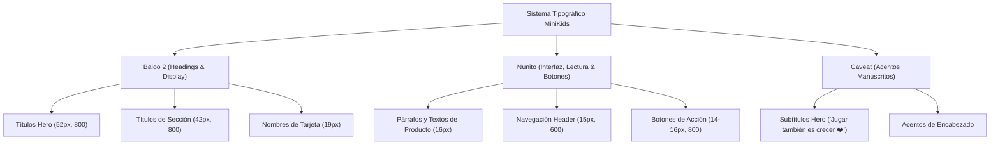
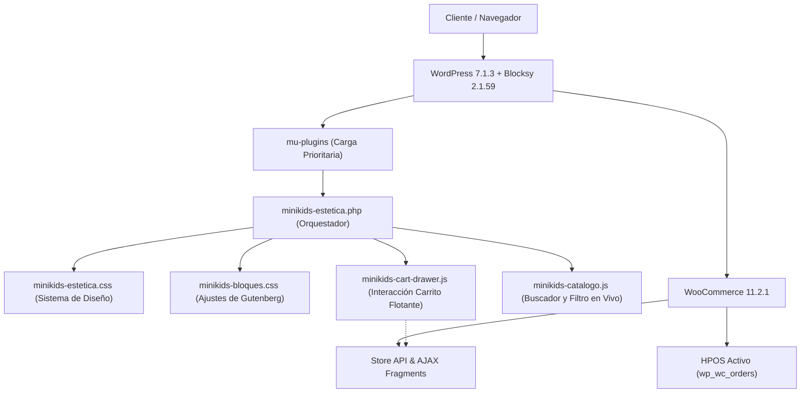

# Manual de Diseño y Arquitectura · MiniKids 🎈

Bienvenido al manual oficial de diseño, identidad visual y arquitectura técnica del proyecto **MiniKids**. Este documento define la fuente de verdad del sistema de diseño (Design System), los tokens visuales, las pautas de accesibilidad y las reglas de ingeniería para mantener total coherencia entre el prototipo interactivo y la implementación en WordPress + WooCommerce.

---

## 1. Filosofía de Marca y Concepto

> [!NOTE]
> **Eslogan de Marca:** *"Jugar hoy, un mejor mañana ❤️"*  
> **Propósito:** MiniKids combina la calidez y alegría del juego infantil con la confianza, seguridad y claridad que los padres buscan al comprar online.

### Principios de Diseño
1. **Lúdico pero ordenado:** Uso de tonos pasteles amigables combinados con bordes definidos y tipografía legible para evitar el desorden visual.
2. **Claridad en la compra:** Botones de llamada a la acción (CTA) de alto contraste en amarillo de marca (`#ffd60a`), badges de descuento inmediatos y retroalimentación interactiva al añadir al carrito.
3. **Respeto absoluto a la ingeniería:** Cero modificaciones invasivas al código de terceros; personalización estética modular mediante `mu-plugins` y CSS puro.

---

## 2. Paleta de Colores Oficial (Design Tokens)

La paleta se divide en colores de marca primarios, tonos pastel para fondos temáticos y neutros de estructura.

### Colores de Marca y Acento

| Variable CSS | Valor HEX | Muestra | Rol y Casos de Uso |
| :--- | :---: | :---: | :--- |
| `--brand-yellow` | `#ffd60a` | `🟡 #ffd60a` | **Botones CTA primarios**, barra superior TopBar, acentos clave. |
| `--brand-yellow-dark` | `#f5c400` | `🟡 #f5c400` | **Hover de botones amarillos** y estados activos. |
| `--brand-blue` | `#1a73e8` | `🔵 #1a73e8` | **Enlaces**, estados activos de navegación, focus rings, botón newsletter. |
| `--brand-sky` | `#4cb6f3` | `🌐 #4cb6f3` | Hover sutil de tarjetas y bordes secundarios. |
| `--brand-red` | `#ef233c` | `🔴 #ef233c` | **Badges de oferta**, contador del carrito, precios de rebaja, corazones. |
| `--brand-ink` | `#111111` | `⚫ #111111` | **Texto principal**, headings, botones oscuros secundarios. |

### Fondos Pastel y Estados

| Variable CSS | Valor HEX | Muestra | Categoría / Contexto |
| :--- | :---: | :---: | :--- |
| `--pastel-yellow` | `#fdeea6` | `🟨 #fdeea6` | Categorías Didácticos / Creatividad, badges de edad. |
| `--pastel-blue` | `#dceefc` | `🟦 #dceefc` | Categorías Vehículos / Aire Libre, barra de progreso de envío gratis. |
| `--pastel-cream` | `#fdf4e3` | `🟫 #fdf4e3` | **Fondo de galería de producto**, contenedor de imágenes. |
| `--pastel-pink` | `#fde3ea` | `🌸 #fde3ea` | Categorías Peluches / Juegos de Familia, badges de descuento. |
| `--pastel-green` | `#e1f6ec` | `🟩 #e1f6ec` | Categoría Tecnología, tags *"En stock"*, aviso de añadido exitoso. |
| `--muted` | `#f5f6f8` | `⚪ #f5f6f8` | Fondo de cajas secundarias y badges de confianza. |
| `--border` | `#e6e8ec` | `◽ #e6e8ec` | Bordes de tarjetas, tablas y separadores. |

---

## 3. Tipografía y Jerarquía Visual

Importación oficial en `<head>`:
```html
<link href="https://fonts.googleapis.com/css2?family=Baloo+2:wght@600;700;800&family=Nunito:wght@400;600;700;800;900&family=Caveat:wght@600;700&display=swap" rel="stylesheet">
```

### Roles Tipográficos



---

## 4. Componentes UI de la Tienda

### 4.1. Barra Superior (TopBar)
* **Ubicación:** Cima absoluta de la web, inyectada vía `blocksy:header:before`.
* **Estilo:** Fondo `#ffd60a`, texto `#111111`, padding `8px 16px`, fuente Nunito 600, centrado.
* **Mensaje:** `Atendemos de lunes a viernes de 9am a 6pm • Envíos a todo el Perú`.

### 4.2. Header & Navbar Sticky Permanente
* **Comportamiento en Scroll:** `position: sticky; top: 0` (o `32px` con barra admin de WordPress), `z-index: 9999`. Permanece visible y fijado a lo largo de todo el scroll en todas las páginas gracias a la desactivación del clipping en `#main-container { overflow: visible !important; }`.
* **Fondo y Desenfoque:** `rgba(255, 255, 255, 0.98)` con `backdrop-filter: blur(8px)`.
* **Logo:** 165px × 52px con hover sutil `scale(1.03)`.
* **Enlaces:** Nunito 15px/600, color `#111111`, hover azul `#1a73e8`, subrayado animado de 2px azul en ítem activo.
* **Botón de Carrito (Circular 42px × 42px):**
  - Botón circular idéntico al prototipo Next.js (`width: 42px; height: 42px; border-radius: 50%`).
  - Hover suave en amarillo pastel (`--pastel-yellow`) con rotación juguetona del icono (`rotate(-6deg)`).
  - Badge de contador circular rojo (`#ef233c`) posicionado de forma absoluta en la esquina superior derecha (`top: -2px; right: -2px;`), sin deformar el botón.
  - Ocultación del dropdown nativo de Blocksy para dar paso exclusivo al drawer lateral deslizante.

### 4.3. Hero Banner
* **Dimensiones:** Mínimo 520px de altura con fondo `hero-bg-limpio.jpg`.
* **Overlay:** Gradiente lineal de izquierda a derecha `linear-gradient(to right, rgba(255, 255, 255, 0.94) 0%, rgba(255, 255, 255, 0.75) 50%, rgba(255, 255, 255, 0.2) 100%)`.
* **Acciones:**
  - Botón primario: Amarillo `#ffd60a`, elevación `-2px` en hover.
  - Botón secundario: Outline blanco con borde negro `#111111`.

### 4.4. Tarjetas de Categorías (7 Columnas)
* **Fondo temático pastel:**
  - Peluches / Juegos familiares: `#fde3ea`
  - Didácticos / Vehículos: `#dceefc`
  - Juegos de rol / Creatividad: `#fdeea6`
  - Tecnología: `#e1f6ec`
* **Imagen:** `aspect-ratio: 1/1`, `object-fit: contain`, efecto `mix-blend-mode: multiply`.

### 4.5. Tarjetas de Producto
* **Estructura:**
  - Tarjeta blanca con borde `#e6e8ec`, `border-radius: 16px`, padding 12px.
  - Hover: elevación `translateY(-4px)`, borde transparente y sombra `box-shadow: 0 12px 28px rgba(17, 17, 17, 0.08)`.
  - Badge de oferta: píldora roja (`#ef233c`) en esquina superior izquierda.
  - Botón de añadir: 100% ancho, amarillo `#ffd60a`, tipografía Nunito 800.

### 4.6. Carrito Flotante (Slide-in Cart Drawer)
* **Activación:** 
  1. Al hacer clic en el icono de carrito del header (desktop y móvil).
  2. **Automático:** Cada vez que el cliente pulsa *"Agregar al carrito"* en cualquier producto mediante AJAX.
* **Componentes internos:**
  - **Encabezado:** Baloo 2 "Tu carrito (X)" y botón circular de cierre (X).
  - **Barra de Envío Gratis:** Aviso dinámico con barra de progreso calculada sobre la meta de **S/ 149**.
  - **Lista de productos:** Miniatura, nombre, cantidad, precio e icono de papelera.
  - **Footer:** Subtotal, botón amarillo *"Finalizar compra >"* y botón *"Seguir comprando"*.

### 4.7. Footer Global Unificado (5 Columnas)
Se inyecta en todas las páginas para garantizar armonía absoluta:
1. **Columna 1 (Marca):** Logo de MiniKids + eslogan *"Jugar hoy, un mejor mañana ❤️"*.
2. **Columna 2 (Tienda):** Enlaces a Inicio, Juguetes, Categorías, Novedades, Ofertas.
3. **Columna 3 (Ayuda):** Preguntas frecuentes, Cambios y devoluciones, Envíos, Contacto.
4. **Columna 4 (Síguenos):** Iconos vectoriales SVG limpios de Instagram, Facebook, YouTube y TikTok con micro-animación en hover.
5. **Columna 5 (Newsletter):** Campo de email con botón azul `#1a73e8`, feedback interactivo instantáneo y copyright.

### 4.8. Catálogo Interactivo y Buscador en Vivo (Tienda & Sitewide)
- **Buscador en Vivo:** Campo con borde redondeado `50px`, icono de lupa y botón limpiar `✕`. Normalización insensible a tildes/mayúsculas (ej. *"camion"* encuentra *"Camión de Construcción"*).
- **Filtrado por Etiquetas & Píldora de Reset:** Píldoras interactivas con cambio instantáneo (0 ms sin recargas de página) vía clase CSS `.minikids-product-hidden` (`display: none !important;`).
- **Botón Dinámico "Limpiar filtro ✕":** Se encuentra integrado orgánicamente junto a las demás píldoras de categoría (`.minikids-pill-reset`). Aparece exclusivamente cuando existe un filtro de categoría o término de búsqueda activo, con estilo pastel rosa (`#fde3ea`) y hover rojo vivo (`#ef233c`).
- **Sincronización de URL:** Actualiza parámetros limpios `?cat=` y `?q=` con `history.pushState` para permitir compartir enlaces o volver atrás con el navegador.
- **Redirección Global:** Las búsquedas desde el modal de cabecera en cualquier página redirigen a `/tienda/?q=...`, evitando páginas de blog vacías o irrelevantes.

---

## 5. Arquitectura Técnica en WordPress



### Reglas Inquebrantables de Desarrollo
1. **No tocar PHP de plugins de terceros:** Cero modificaciones en WooCommerce o Blocksy.
2. **Todo estilo en mu-plugins:** `minikids-estetica.css` y `minikids-bloques.css` controlan el 100% del diseño.
3. **Contenido nativo de bloques:** Bloques estándar `<!-- wp:... -->` sin HTML crudo desestructurado.
4. **Preservar WooCommerce:** Mantener funcionales los fragments de AJAX, pasarelas de pago y HPOS.
5. **Verificación obligatoria:** Cada cambio debe validarse mediante comprobación HTTP y respuesta 200 OK.
