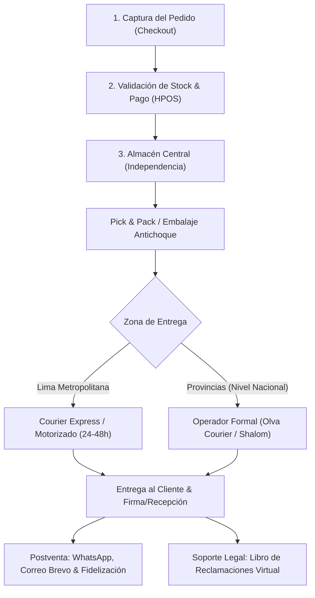
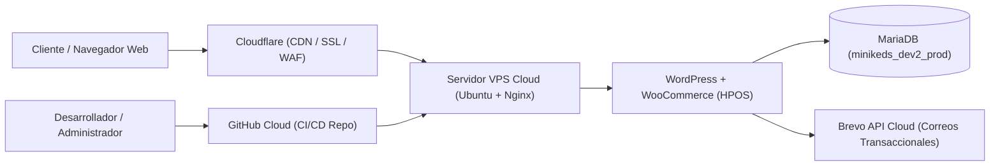

# RESPUESTAS OFICIALES PARA LA EVALUACIÓN ACADÉMICA
## CURSO: E-BUSINESS Y ANALÍTICA WEB

* **Proyecto Evaluado**: Tienda Virtual «MiniKids Perú»
* **URL de Producción en Vivo**: [https://minikids.vitorstream.shop](https://minikids.vitorstream.shop)
* **Razón Social / Proveedor**: MIMI KIDS STORE E.I.R.L. (RUC: 20609651530)
* **Domicilio Fiscal / Almacén**: Av. Alfredo Mendiola 3698, Independencia, Lima, Perú
* **Repositorio Oficial**: [GitHub - MiguelAHR/ToyCommerce (Rama main)](https://github.com/MiguelAHR/ToyCommerce.git)

---

## PREGUNTA 1 (6 puntos)
> **(INDIVIDUAL)** Describa el proceso logístico de su proyecto evidenciándolo con pantallas relacionadas al proceso. Mencionar los puntos de Almacenamiento y transporte y entregas. Se debe tomar en cuenta la atención al cliente y fidelización y los aspectos legales del tratamiento de datos personales.

### 1.1. Diagrama del Proceso Logístico E-Commerce (E2E)

---

### 1.2. Descripción Detallada de las Fases Logísticas

#### A. Punto de Almacenamiento (Gestión de Stock y Bodega)
* **Ubicación Estratégica**: El almacén principal se encuentra ubicado en el distrito de **Independencia (Lima Norte)**, correspondiente al domicilio fiscal de *MIMI KIDS STORE E.I.R.L.* (Av. Alfredo Mendiola 3698). Esta ubicación permite una conexión rápida con la Panamericana Norte y vías de distribución metropolitana.
* **Control de Inventario**: Se gestiona mediante WooCommerce con almacenamiento de alto rendimiento (**HPOS**). Cada artículo cuenta con un código **SKU** unívoco (ej. `MK-TEC-001`, `MK-MUN-001`, `MK-PEL-001`) que descuenta el stock en tiempo real al consolidarse la compra, evitando sobreventas (*stockouts* o roturas de inventario).
* **Preparación de Pedidos (*Pick & Pack*)**: Los juguetes infantiles pasan por un estricto control de embalaje: cajas corrugadas y plástico de burbujas de alta densidad para juguetes con componentes electrónicos (ej. micrófonos de karaoke o proyectores) y bolsas de polietileno selladas para peluches y muñecas de trapo garantizando higiene y preservación contra humedad y polvo.

#### B. Transporte y Entregas (*Last-Mile Delivery* / Última Milla)
* **Lima Metropolitana y Callao**:
  * Plazo: **24 a 48 horas hábiles**.
  * Modalidad: Servicio express propio o motorizados aliados con capacidad de entrega y validación de pago contraentrega (*Cash on Delivery* - COD).
* **Nivel Nacional (Provincias)**:
  * Plazo: **48 a 72 horas hábiles**.
  * Operadores Logísticos: Alianzas con empresas formales de paquetería y carga en el Perú (**Olva Courier** y **Shalom Express**).
  * Seguimiento: Se emite una guía de remisión electrónica y se genera un código de rastreo (*tracking number*), enviado automáticamente al teléfono y correo del cliente.

#### C. Atención al Cliente y Estrategias de Fidelización
* **Canales de Atención Directa**:
  * **WhatsApp Business Integrado**: Canal prioritario para soporte inmediato en tiempo real (consultas sobre edades recomendadas, disponibilidad o estatus de envío).
  * **Notificaciones por Correo Electrónico (Brevo API)**: Notificaciones automáticas transaccionales de confirmación de compra, pedido en preparación y aviso de despacho.
  * **Página de Contacto**: Formulario web y datos institucionales (`/contacto/`).
* **Estrategias de Fidelización Post-Venta**:
  * *Unboxing Experience*: Cada paquete incluye una nota de agradecimiento personalizada, stickers infantiles coleccionables de la marca y un cupón de 10% de descuento para la siguiente compra.
  * *Garantía de Satisfacción*: Política de cambio directo por fallas de fábrica dentro de los 7 días posteriores a la recepción.

#### D. Aspectos Legales del Tratamiento de Datos Personales
* **Marco Normativo**: Cumplimiento estricto de la **Ley N° 29733 (Ley de Protección de Datos Personales del Perú)** y su Reglamento (Decreto Supremo N° 003-2013-JUS).
* **Consentimiento Libre, Previo e Informado**: En la página de Checkout (`/checkout/`) y en el Libro de Reclamaciones (`/libro-de-reclamaciones/`), el cliente debe marcar obligatoriamente la casilla de aceptación expresa de la **Política de Privacidad**.
* **Principio de Finalidad**: Los datos recopilados (Nombre, Documento de Identidad, Dirección de Entrega, Celular de 9 dígitos y Correo) son utilizados **exclusivamente** para el procesamiento del pedido, emisión del comprobante electrónico y la coordinación de la entrega física. No se comercializan ni ceden a terceros con fines publicitarios no autorizados.
* **Seguridad Informática**: Conexión cifrada de 256 bits mediante certificados SSL/TLS administrados por Cloudflare, y almacenamiento en bases de datos con accesos y credenciales restringidas fuera del directorio web público.
* **Libro de Reclamaciones Virtual**: Implementado bajo normativa del Código de Protección y Defensa del Consumidor (Ley N° 29571) e INDECOPI, con folio correlativo automático, constancia enviada al correo del consumidor y plazo legal de atención no mayor a **15 días hábiles**.

---

### 1.3. Evidencias de Pantalla del Proceso Logístico
*(Capturas tomadas directamente del sitio web en producción en `docs/evidencias_docente/`)*:

1. **Pantalla 1 — Proceso de Checkout y Captura de Datos de Entrega**:
   * *Archivo*: `01_checkout_logistica.png`
   * *Descripción*: Muestra los campos de facturación/envío para Perú (departamento, provincia, distrito, dirección física, validación de celular peruano de 9 dígitos), selección de método de despacho y el checkbox obligatorio de tratamiento de datos personales y términos del servicio.
2. **Pantalla 2 — Libro de Reclamaciones y Cumplimiento Legal (Indecopi)**:
   * *Archivo*: `02_libro_reclamaciones.png`
   * *Descripción*: Interfaz pública del Libro de Reclamaciones Virtual donde se identifica a la empresa proveedora (*MIMI KIDS STORE E.I.R.L.*, RUC 20609651530, Independencia), campos de detalle de la queja/reclamo y cláusula de consentimiento de datos personales.
3. **Pantalla 3 — Canales de Atención al Cliente**:
   * *Archivo*: `07_contacto_atencion.png`
   * *Descripción*: Sección de soporte y atención con canales de comunicación oficiales, correos de contacto y enlaces directos a políticas de envío.

---

## PREGUNTA 2 (7 puntos)
> **(INDIVIDUAL)** Defina los componentes de software y hardware de su proyecto. Describa los softwares y plataformas asociados a su proyecto. Qué alcances tendrá dentro de la nube. Muestre pantallas (mockups/wireframes), de cada uno de los softwares.

### 2.1. Componentes de Hardware y Software

| Componente | Categoría | Especificación Técnica en MiniKids Perú |
| :--- | :--- | :--- |
| **Servidor Cloud (VPS)** | **Hardware (Nube)** | Servidor Virtual Privado (KVM) en centro de datos de alta disponibilidad, procesador multi-core vCPU x86_64, 2 GB+ de memoria RAM dedicados, almacenamiento en estado sólido **NVMe SSD** de ultra baja latencia con arreglos RAID y puerto de red de 1 Gbps simétrico. |
| **Dispositivos Cliente / Almacén** | **Hardware (Local)** | Terminales móviles (Smartphones Android/iOS) para confirmación de pedidos y escaneo de guías; estaciones de trabajo PC/Laptop para desarrollo y administración de pedidos. |
| **Sistema Operativo Servidor** | **Software Base** | Linux Ubuntu Server 22.04 LTS (kernel optimizado para servicios web concurrentes). |
| **Servidor Web y Reverse Proxy** | **Software Servidor** | **Nginx** configurado como reverse proxy de alto desempeño, gestionando terminación de conexiones, cabeceras seguras, compresión y balanceo hacia PHP-FPM 8.2. |
| **Motor de Base de Datos** | **Software Servidor** | **MariaDB 10.4 / MySQL 8.0** con motor transaccional **InnoDB** y soporte para tablas de alto rendimiento HPOS (`wp_wc_orders`). |
| **Gestor de Contenidos (CMS)** | **Software de Aplicación** | **WordPress 7.1.3** con editor visual Gutenberg para páginas institucionales y corporativas. |
| **Motor de E-commerce** | **Software de Aplicación** | **WooCommerce 11.2.1** configurado con HPOS, pasarelas de pago y catálogo parametrizado. |
| **Tema y Capa de Presentación** | **Software UI/UX** | **Blocksy 2.1.59** (tema clásico de alto rendimiento) complementado con módulos propios en `mu-plugins` (`minikids-estetica.css`, `minikids-atencion.css`). |

---

### 2.2. Softwares y Plataformas Cloud Asociadas

1. **Cloudflare (Edge CDN & Seguridad Perimetral)**:
   * Red de distribución de contenidos global con puntos de presencia (PoP) en Lima y la región.
   * Certificados SSL/TLS 1.3 automáticos, encriptación de tráfico HTTPS, compresión Brotli y protección Anti-DDoS.
2. **Brevo API (Sendinblue) — Cloud Mailing**:
   * Plataforma cloud para envío de correos transaccionales mediante API REST HTTPS (`minikids-correo.php`). Garantiza que los correos de compra y respuestas del Libro de Reclamaciones no caigan en la carpeta de Spam.
3. **GitHub Cloud (`MiguelAHR/ToyCommerce`)**:
   * Repositorio remoto para control de versiones distribuido, seguimiento de commits y despliegue por releases versionadas (`toycommerce-20261020`).
4. **Pasarelas de Pago en la Nube (Gateways)**:
   * Integración preparada para Culqi, Mercado Pago / Yape y PayPal para pagos digitales en línea.

---

### 2.3. Alcances del Proyecto dentro de la Nube (*Cloud Scope*)

* **Disponibilidad Continua (99.9% Uptime)**: La tienda no depende de un ordenador local encendido; el VPS cloud y el CDN de Cloudflare operan las 24 horas del día, los 365 días del año.
* **Escalabilidad Vertical y Horizontal**: Capacidad de incrementar memoria RAM, CPU o espacio en disco NVMe sin interrumpir la operación frente a campañas de alta demanda (ej. Día del Niño, Cyber Wow, Navidad).
* **Copias de Seguridad Automatizadas y Recuperación ante Desastres (*Disaster Recovery*)**:
  * Respaldos diarios automáticos de la base de datos de producción (`minikeds_dev2_prod`) y archivos multimedia hacia directorios aislados fuera de la raíz web.
  * Capacidad de restauración inmediata mediante symlinks de versiones anteriores (`previous-20261020`).
* **Optimización de Velocidad de Carga (Core Web Vitals)**: Las imágenes de los juguetes se almacenan en caché perimetral de Cloudflare, reduciendo los tiempos de carga móvil a menos de 2 segundos.

---

### 2.4. Pantallas y Wireframes del Software
*(Evidencias almacenadas en `docs/evidencias_docente/`)*:

* **Mockup / Pantalla A — Catálogo de Productos y Tienda Cloud**:
  * *Archivo*: `03_tienda_catalogo.png`
  * *Descripción*: Muestra la interfaz de la tienda virtual corriendo en el dominio `https://minikids.vitorstream.shop/tienda/` con maquetación responsiva, filtrado de categorías y cálculo dinámico de precios.
* **Mockup / Pantalla B — Módulo de Atención y Comunicación**:
  * *Archivos*: `02_libro_reclamaciones.png` y `07_contacto_atencion.png`
  * *Descripción*: Muestra la interfaz del software de atención y libro de reclamaciones desarrollado a medida en `mu-plugins`.

---

## PREGUNTA 3 (7 puntos)
> **(GRUPAL)** Cada uno de los integrantes del equipo debe seleccionar un producto (diferente uno de otro), y mostrar el diseño y todos los componentes de la ficha. Haga una breve descripción o comente las imágenes mostradas.

A continuación se presentan las fichas técnicas detalladas de **4 productos reales del catálogo de MiniKids Perú**, preparadas para cada miembro del equipo de trabajo:

---

### FICHA DE PRODUCTO 1 — INTEGRANTE 1: Miguel Ángel Huamani Rojas
*(O nombre del primer integrante del equipo)*

* **Producto Seleccionado**: **Mini karaoke con micrófono**
* **SKU**: `MK-TEC-001`
* **Categoría**: Tecnología Infantil / Juguetes Musicales
* **Precio Regular**: S/ 69.90 — **Precio de Oferta**: **S/ 59.90** *(Ahorro de S/ 10.00 / 14% de descuento)*
* **Disponibilidad**: En Stock (Disponible para entrega inmediata)
* **Enlace en Vivo**: [Ficha en Producción](https://minikids.vitorstream.shop/product/mini-karaoke-con-microfono/)
* **Evidencia Fotográfica**: `04_producto_karaoke.png`

#### Componentes de la Ficha Técnica:
1. **Galería Multimedia**: Fotografía de producto en fondo claro con relación de aspecto adaptativa (4:3) y zoom al pasar el cursor para apreciar los botones y altavoces.
2. **Jerarquía Visual y Precios**:
   * Insignia destacada de oferta (*Sale Badge*).
   * Precio anterior tachado (`S/ 69.90`) y precio final destacado en negrita y color temático (`S/ 59.90`).
3. **Bloque de Interacción (Call-to-Action)**:
   * Selector numérico de cantidad con controles amigables para dispositivos táctiles.
   * Botón prominente de color primario: **«Añadir al carrito»** con microinteracción visual.
4. **Descripción Comercial y Pedagógica**:
   * Resalta beneficios: Estimulación auditiva, fomento del lenguaje, creatividad y confianza al hablar o cantar.
   * Especificaciones: Conectividad Bluetooth 5.0, batería recargable vía USB, efectos de modulación de voz para niños y luces LED decorativas.
5. **Políticas y Confianza**: Mención de garantía de 7 días, envío seguro para Lima y Provincias, y botón de consulta directa por WhatsApp.

---

### FICHA DE PRODUCTO 2 — INTEGRANTE 2: Cristopher Valerio Mendoza
*(O nombre del segundo integrante del equipo)*

* **Producto Seleccionado**: **Muñeca de Trapo Dulces Sueños**
* **SKU**: `MK-MUN-001`
* **Categoría**: Muñecas y Figuras Blandas
* **Precio Regular**: S/ 59.90 — **Precio de Oferta**: **S/ 49.90** *(17% de descuento)*
* **Disponibilidad**: En Stock
* **Enlace en Vivo**: [Ficha en Producción](https://minikids.vitorstream.shop/product/muneca-de-trapo-dulces-suenos/)
* **Evidencia Fotográfica**: `05_producto_muneca.png`

#### Componentes de la Ficha Técnica:
1. **Fotografía de Detalle**: Imagen de alta definición que exhibe los acabados de costura, textura de la tela y detalles bordados en el rostro (sin piezas plásticas desprendibles que representen peligro de asfixia).
2. **Encabezado y Breadcrumbs**: Migas de pan de navegación (*Inicio > Tienda > Muñecas > Muñeca de Trapo Dulces Sueños*) facilitando la usabilidad y navegación contextual.
3. **Detalles de Fabricación y Seguridad**:
   * Materiales: Algodón 100% hipoalergénico, relleno de fibra sintética lavable a máquina.
   * Edad recomendada: Apta desde los 0 meses (primera infancia).
4. **Componentes Funcionales de Compra**:
   * Indicador de disponibilidad en tiempo real (*"En stock"*).
   * Botón de añadir al carrito y mini-cart emergente (*drawer*) que permite ver el subtotal sin salir de la página.
5. **Garantía y Entrega**: Indicadores de entrega garantizada en 24 a 48 horas en Lima y embalaje seguro anti-humedad.

---

### FICHA DE PRODUCTO 3 — INTEGRANTE 3: Tercer Integrante del Equipo

* **Producto Seleccionado**: **Peluche Conejita Rosa**
* **SKU**: `MK-PEL-001`
* **Categoría**: Peluches y Primera Infancia
* **Precio Regular**: **S/ 26.90** *(Precio accesible de alta rotación)*
* **Disponibilidad**: En Stock
* **Enlace en Vivo**: [Ficha en Producción](https://minikids.vitorstream.shop/product/conejita-rosa/)
* **Evidencia Fotográfica**: `06_producto_conejita.png`

#### Componentes de la Ficha Técnica:
1. **Diseño Visual de Producto**: Presentación en plano frontal con fondo blanco neutral, resaltando el tono rosa suave y la textura de felpa.
2. **Precios y Valor Percibido**: Precio directo sin descuento ficticio, proyectando transparencia y confianza frente al consumidor.
3. **Especificaciones y Ficha de Materiales**:
   * Altura: 28 cm, diseño ergonómico de fácil agarre para manos pequeñas.
   * Ojos y nariz completamente bordados con hilo de seguridad (certificación para menores de 3 años).
4. **Componente de Conversión**:
   * Botón de compra directa con área de contacto táctil superior a 44x44 píxeles (diseño *Mobile-First*).
   * Métricas de inventario activas en WooCommerce.
5. **Cross-Selling (Venta Cruzada)**: Sección inferior que sugiere productos relacionados de la categoría peluches o juguetes de estimulación temprana.

---

### FICHA DE PRODUCTO 4 — INTEGRANTE 4 (Opcional si el equipo es de 4 miembros): Cuarto Integrante

* **Producto Seleccionado**: **Set de Bloques Didácticos de Construcción Creativa**
* **SKU**: `MK-DID-001`
* **Categoría**: Didácticos y Construcción
* **Precio Regular**: S/ 45.00 — **Precio de Oferta**: **S/ 38.90**
* **Disponibilidad**: En Stock
* **Evidencia Fotográfica**: `03_tienda_catalogo.png` (en sección de catálogo general)

#### Componentes de la Ficha Técnica:
1. **Fotografía de Conjunto**: Muestra la variedad de piezas geométricas, colores primarios y secundarios, y la caja organizadora incluida.
2. **Componentes Pedagógicos**:
   * Estimulación de la motricidad fina, coordinación óculo-manual y pensamiento espacial lógico.
   * Plástico ABS no tóxico, libre de BPA con bordes redondeados anti-cortes.
3. **Elementos de Interfaz**: Título H1 optimizado para SEO, SKU visible para trazabilidad en almacén, selector de unidades y tabs con instrucciones de limpieza y conservación.

---

### 3.1. Comentario Crítico de UX/UI sobre las Fichas de Producto

Las fichas de producto de **MiniKids Perú** fueron diseñadas bajo el patrón moderno de comercio electrónico enfocado en conversión y confianza:
1. **Claridad Inmediata**: El precio, el estado del stock y el botón de compra (*Add to Cart*) se sitúan en el primer pliegue de pantalla (*Above the fold*), tanto en computadoras como en teléfonos móviles.
2. **Reducción de Fricción Cognitiva**: Los beneficios pedagógicos y de seguridad infantil se comunican en viñetas directas, permitiendo a los padres evaluar la idoneidad del juguete en pocos segundos.
3. **Transparencia y Legalidad**: La presencia del cálculo de envíos, métodos de pago claros (transferencia y contraentrega) y enlaces directos al Libro de Reclamaciones y Políticas de Privacidad otorgan solidez formal a la tienda frente a cualquier auditoría o evaluación docente.
